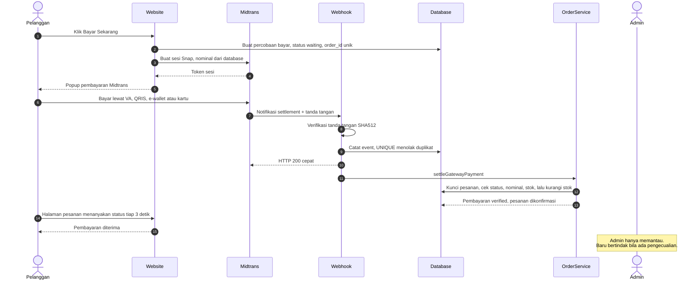
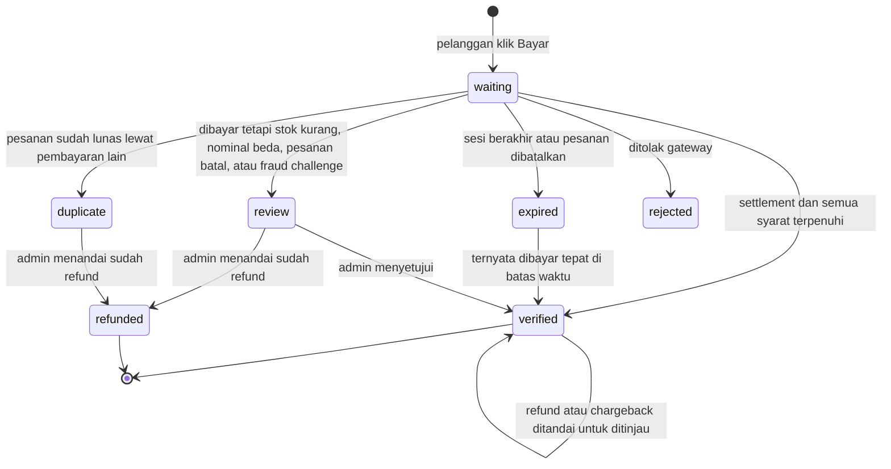
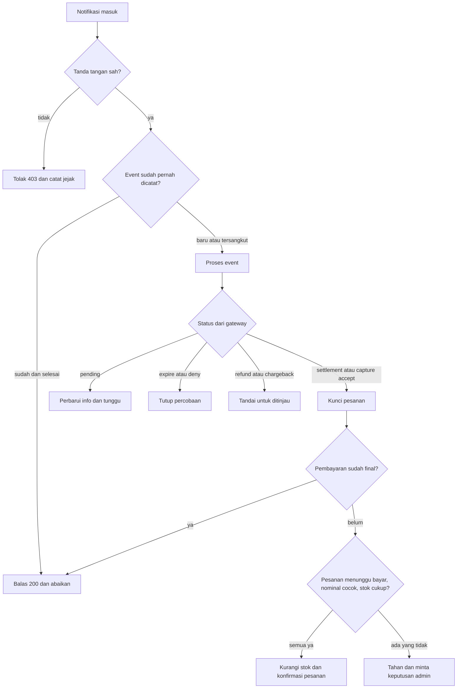

# Alur Pembayaran Otomatis (Midtrans) — Roastery Supply

Dokumen ini menjelaskan bagaimana pembayaran online dikonfirmasi **otomatis, satu jalur, dan tanpa bentrok**, sehingga admin
cukup memantau dan hanya bertindak bila ada pengecualian.

## 1. Masalah yang diselesaikan

| Sebelumnya (transfer manual) | Sekarang (gateway) |
|---|---|
| Pelanggan unggah bukti, admin cek mutasi lalu klik verifikasi satu per satu | Pembayaran terkonfirmasi sendiri dalam hitungan detik |
| Admin = pemeriksa | Admin = pemantau pengecualian |
| Bayar dua kali: baru ketahuan saat admin mengecek | Notifikasi ganda dan bayar ganda ditangani otomatis dan tercatat |

Transfer manual **tetap tersedia** sebagai alternatif (pembeli mesin bernilai besar sering lebih nyaman transfer bank).

## 2. Gambaran besar



### Satu jalur ke persetujuan

Semua jalan berakhir di **satu fungsi**: `OrderService`, satu-satunya tempat yang boleh mengubah status pesanan dan stok.

```
 Webhook Midtrans ─┐
 Pengecekan terjadwal ─┼──> OrderService::settleGatewayPayment() ──> status pesanan + stok
 Klik admin "Setujui" ─┘          (kunci baris database)
 Klik admin "Verifikasi" (manual) ──> OrderService::confirmPayment()   (kunci yang sama)
```

## 3. Status pembayaran



## 4. Mengapa tidak bentrok: enam lapis pengaman

| Lapis | Mekanisme | Melindungi dari |
|---|---|---|
| 1 | **Tanda tangan SHA512** (`order_id + status_code + gross_amount + ServerKey`) | Notifikasi palsu atau nominal diubah |
| 2 | **Indeks UNIQUE di database**: `payment_events (provider, event_key)` dan `payments.provider_order_id` / `provider_transaction_id` | Notifikasi ganda, sesi ganda. Dijamin database, bukan if-else, jadi aman walau dua request tiba pada milidetik yang sama |
| 3 | **Pemrosesan idempoten**: event yang sudah selesai tidak diproses lagi, hasil hanya ditulis pemroses pertama | Pemrosesan ulang |
| 4 | **Kunci baris database** (`lockForUpdate`) pada pesanan lalu pembayaran lalu produk, urutan sama di semua jalur | Webhook vs klik admin, dua notifikasi bersamaan, rebutan stok |
| 5 | **Pemeriksaan status di dalam kunci** | Notifikasi terlambat atau tidak berurutan memundurkan status final |
| 6 | **Pengecekan terjadwal ke Status API** (`payments:reconcile`, tiap 5 menit) | Webhook yang hilang, dan sesi Snap yang kedaluwarsa (Midtrans tidak mengirim notifikasi untuk itu) |

Tambahan di sisi pelanggan: satu pesanan hanya punya **satu sesi aktif** (klik ganda memakai token yang sama), dan sesi
lain otomatis ditutup (termasuk di Midtrans) begitu salah satunya lunas.



## 5. Kasus tepi dan perlakuannya

Prinsip: **uang yang sudah masuk tidak boleh hilang atau menimbulkan error**. Kasus yang butuh manusia ditahan dengan alasan jelas.

| Situasi | Perlakuan otomatis | Admin | Uji |
|---|---|---|---|
| Notifikasi sama datang berkali-kali | Hanya yang pertama diproses, sisanya dibalas 200 | Tidak ada | P-02, K-1 |
| Tanda tangan salah / nominal dimanipulasi | Ditolak 403, tercatat sebagai jejak | Tidak ada | P-03 |
| Webhook bersamaan dengan klik admin | Satu menang, yang kalah tercatat jelas | Tidak ada | P-04, P-22, K-2, K-6 |
| Dibayar, stok tidak cukup | Ditahan, alasan menyebut produk dan sisa stok | Tambah stok lalu Setujui, atau refund | P-07, K-3 |
| Bayar dua kali (dua sesi) | Yang kedua dicatat "ganda", pesanan tidak disentuh | Refund | P-06 |
| Transfer manual dan bayar online sekaligus | Pemenang diterapkan, yang lain ditahan "ganda" | Periksa mutasi, refund bila masuk | P-21 |
| Dibayar setelah pesanan dibatalkan | Ditahan | Refund | P-08 |
| Nominal tidak sama dengan tagihan | Ditahan | Tinjau | P-09 |
| Kartu kredit ditahan anti-fraud | Ditahan, otomatis lanjut bila Midtrans menyetujui | Putuskan di dashboard Midtrans | P-10 |
| Notifikasi tidak berurutan | Status final tidak dimundurkan | Tidak ada | P-11 |
| Sesi bayar habis | Percobaan ditutup, pelanggan bisa mulai lagi | Tidak ada | P-12, P-19 |
| Refund / chargeback setelah lunas | Status uang tetap, ditandai untuk ditinjau | Tinjau pesanan | P-13 |
| Webhook tidak pernah sampai | Dipulihkan pengecekan terjadwal | Tidak ada | P-18 |
| Server mati saat memproses | Gateway mengulang notifikasi; event tersangkut dikirim ulang | Tidak ada | (mode antrean: P-23) |

## 6. Skema database

- `payments` (kolom baru): `provider`, `provider_order_id` **UNIQUE**, `provider_transaction_id` **UNIQUE**, `payment_type`, `gateway_status`,
  `snap_token`, `redirect_url`, `gateway_meta`, `expires_at`, `paid_at`, `last_checked_at`, `review_reason`, `reviewed_at`.
- `payment_events`: jejak setiap notifikasi. `UNIQUE (provider, event_key)`, `payload`, `outcome`, `source` (webhook / reconcile / simulasi), `attempts`.
- `event_key` = SHA1 dari `order_id | transaction_id | transaction_status | status_code | fraud_status | gross_amount`. Kejadian yang sama selalu menghasilkan kunci yang sama.
- `order_id` yang dikirim ke Midtrans adalah `NOMOR-PESANAN-P1`, `-P2`, dst., karena Midtrans tidak mengizinkan `order_id` dipakai ulang.

## 7. Pengaturan Midtrans Sandbox

1. Buat akun Midtrans dan masuk ke dashboard **Sandbox** (terpisah dari produksi; tidak memakai uang asli).
2. Ambil **Server Key** dan **Client Key** sandbox (cari menu *Access Keys* di pengaturan dashboard; nama menu bisa berubah).
3. Isi `.env`:

       MIDTRANS_SERVER_KEY=SB-Mid-server-xxxx
       MIDTRANS_CLIENT_KEY=SB-Mid-client-xxxx
       MIDTRANS_IS_PRODUCTION=false

4. Daftarkan **Payment Notification URL** di dashboard (bagian pengaturan konfigurasi): `https://DOMAIN-ANDA/webhooks/midtrans`.
   Midtrans harus bisa menjangkau URL itu, jadi di komputer lokal pakai tunnel (mis. ngrok/Cloudflare Tunnel) atau uji di server (Railway).
5. Uji pembayaran dengan **Midtrans Sandbox Payment Simulator** (VA, QRIS, e-wallet, dan kartu uji tersedia di dokumentasi Midtrans: *Testing Payment on Sandbox*).
6. Bila URL belum bisa dijangkau Midtrans, gunakan perintah simulasi di bawah. Jalurnya sama persis dengan notifikasi asli.

### Mode pemrosesan

| Pengaturan | Perilaku | Kapan |
|---|---|---|
| `MIDTRANS_PROCESS_INLINE=true` (default) | Diproses langsung di dalam request. **Tidak butuh worker.** | Demo, tugas akhir, awal produksi |
| `MIDTRANS_PROCESS_INLINE=false` | Diterima cepat lalu diproses antrean dengan retry bertahap. **Wajib** `php artisan queue:work --tries=6` berjalan terus | Trafik tinggi |

Keduanya aman dari bentrok karena pengamannya ada di database. **Jadwal** (`payments:reconcile`, pembatalan pesanan 24 jam) tetap butuh
`php artisan schedule:work` atau cron `* * * * * php artisan schedule:run` di server.

Midtrans memverifikasi ke Status API sebelum mengubah pesanan **otomatis di produksi**; di sandbox/lokal nonaktif agar simulasi offline bisa jalan
(`MIDTRANS_VERIFY_STATUS_API=true` untuk memaksa).

## 8. Skenario demo untuk sidang (±8 menit)

Siapkan satu pesanan berstatus *Menunggu Pembayaran* (mis. `ORD-…-0001`) dan buka tiga tab: halaman pesanan pelanggan, Admin > Pembayaran, Dashboard.

1. **Alur normal.** Pelanggan klik *Bayar Sekarang*, bayar di simulator Midtrans. Tunjukkan halaman pesanan berubah sendiri menjadi dikonfirmasi, dan stok berkurang. Admin tidak melakukan apa pun; di Dashboard kartu *Pembayaran online* mencatatnya sebagai **Otomatis**.
2. **Notifikasi ganda.** `php artisan payments:simulate ORD-… settlement --times=5`. Hasil: 1× `accepted`, 4× `duplicate`, stok tetap berkurang sekali. Tunjukkan *Riwayat notifikasi* pada detail pembayaran.
3. **Pemalsuan.** `php artisan payments:simulate ORD-… settlement --bad-signature` → HTTP 403, tidak ada yang berubah.
4. **Bayar ganda.** Buat pesanan baru, jalankan `payments:simulate ORD-… settlement` dua kali (sesi kedua dibuat otomatis). Tunjukkan status *Pembayaran ganda* muncul di tab **Perlu perhatian**.
5. **Stok kurang.** Set stok produk menjadi 0, simulasikan pembayaran. Tunjukkan alasan persis (produk dan sisa stok), tambah stok, klik **Setujui pembayaran**.
6. **Penutup.** Tunjukkan tab **Perlu perhatian**: hanya berisi hal yang butuh keputusan manusia. Itulah makna "admin cukup memantau".

## 9. Hasil pengujian

**Otomatis (PHPUnit):** `php artisan test`. Kelompok `GatewayPaymentTest` memuat kasus P-01 s.d. P-23 (tabel kasus tepi di atas). Seluruh suite proyek dijalankan bersama.

**Konkurensi (`tests/Concurrency/`)**, di MariaDB 10.11 (InnoDB), server PHP 12 worker, permintaan HTTP paralel sungguhan:

| Kode | Skenario | Hasil |
|---|---|---|
| K-1 | 16 notifikasi identik serentak | 1 diterima, 15 duplikat; stok 10→8 (sekali); 1 event; 1 pergerakan stok |
| K-2 | 6 webhook + 6 klik admin serentak | 1 pemenang; stok berkurang sekali; yang kalah tercatat jelas |
| K-3 | Stok 1, dua pesanan, 16 notifikasi | 1 pesanan terkonfirmasi; stok 0 (tidak negatif); uang yang kalah ditahan "stok kurang" |
| K-4 | 40 pesanan × 3 notifikasi (120 request, 24 serentak) | 40 terkonfirmasi tepat sekali; stok 1000→960 |
| K-5 | 20 notifikasi tanda tangan palsu | 20× 403; tidak ada perubahan |
| K-6 | Balapan webhook vs admin, 20 putaran, urutan acak | 20/20 invarian terjaga; kedua arah pemenang teruji |

Angka kecepatan di lingkungan uji (K-4: 120 request dalam ±3–6 detik) hanya menunjukkan perilaku di bawah beban, **bukan tolok ukur produksi**.

## 10. Pertanyaan yang mungkin diajukan penguji

**Bagaimana jika Midtrans mengirim notifikasi dua kali?** Setiap notifikasi dicatat dengan kunci unik di database; baris kedua ditolak oleh indeks UNIQUE, jadi tidak diproses lagi (K-1).

**Bagaimana jika webhook dan admin mengonfirmasi bersamaan?** Keduanya lewat `OrderService`, yang mengunci baris pesanan. Yang pertama menang; yang kedua menemukan status sudah final dan ditolak rapi (K-2, K-6).

**Mengapa notifikasi tidak langsung dipercaya?** Tanda tangan SHA512 diverifikasi, nominal dicocokkan dengan database, dan di produksi statusnya dikonfirmasi ulang ke Status API Midtrans.

**Bagaimana jika notifikasi tidak pernah sampai?** Pengecekan terjadwal menanyakan status ke Midtrans; hasilnya masuk lewat jalur pemrosesan yang sama (P-18).

**Bagaimana jika dua orang membeli unit terakhir?** Stok dicek di dalam kunci database. Yang kalah tidak membuat error: uangnya ditahan dengan alasan jelas dan admin memilih refund atau menunggu stok (K-3).

**Mengapa stok tidak dipesan saat checkout?** Pilihan sadar: stok tidak tertahan oleh pesanan yang tak kunjung dibayar. Risikonya (dua pembayar untuk satu unit) ditangani jalur "stok kurang" di atas. Alternatif: reservasi stok selama jendela bayar.

**Mengapa Snap, bukan Core API?** Snap menyediakan halaman bayar siap pakai (VA, QRIS, e-wallet, kartu) tanpa menangani data kartu di server kita, sehingga lebih aman dan cepat diintegrasikan.

**Bagaimana kunci rahasia dilindungi?** Server Key hanya di `.env` server, tidak pernah dikirim ke browser. Browser hanya menerima token sesi dan Client Key.

## 11. Batasan dan pekerjaan lanjutan

- **Refund** dilakukan manual di dashboard Midtrans, lalu admin menandai "sudah direfund". Refund lewat API belum ada.
- Uji otomatis memakai notifikasi simulasi bertanda tangan sah. **Uji juga dengan Midtrans Sandbox sungguhan sebelum sidang** (URL notifikasi, metode bayar yang diaktifkan, dan perilaku halaman Snap).
- Grafik dan agregasi per hari memakai UTC (zona waktu aplikasi). Tampilan jam ke pelanggan dan admin sudah WIB.
- Metode bayar mengikuti yang diaktifkan di akun Midtrans; batas nominal dan biaya per metode perlu dicek langsung ke Midtrans sebelum produksi.

## 12. Daftar periksa go-live

- [ ] Akun Midtrans **produksi** aktif; `MIDTRANS_IS_PRODUCTION=true` dengan kunci produksi.
- [ ] Notification URL produksi terdaftar, HTTPS valid.
- [ ] `php artisan migrate` dijalankan.
- [ ] Penjadwal berjalan (`schedule:work` atau cron) dan, bila mode antrean, `queue:work` berjalan.
- [ ] Satu transaksi nominal kecil sungguhan diuji dari awal sampai terkonfirmasi.
- [ ] Admin memahami tab **Perlu perhatian** dan langkah untuk setiap alasan.
